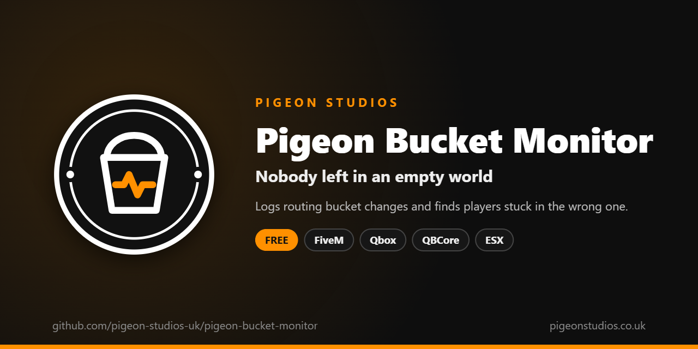

<div align="center">
  

  <h1>Pigeon Bucket Monitor</h1>

  <p><strong>Logs routing bucket changes to Discord, warns when players are stuck in the wrong bucket, and gives staff commands to check and fix them.</strong></p>

  <p>
    <a href="https://github.com/pigeon-studios-uk/pigeon-bucket-monitor/releases/latest"></a>
    <a href="LICENSE.md"></a>
    <a href="https://discord.gg/2NFVWEUmDF"></a>
    
  </p>

  <p>
    <a href="https://github.com/pigeon-studios-uk/pigeon-bucket-monitor/releases/latest"><strong>Download</strong></a> ·
    <a href="#installation">Install</a> ·
    <a href="#commands">Commands</a> ·
    <a href="CHANGELOG.md">Changelog</a> ·
    <a href="https://discord.gg/2NFVWEUmDF">Support</a>
  </p>
</div>

---

## Contents

- [Overview](#overview)
- [Features](#features)
- [What gets reported](#what-gets-reported)
- [Requirements](#requirements)
- [Installation](#installation)
- [Updating](#updating)
- [Commands](#commands)
- [Permissions](#permissions)
- [Configuration](#configuration)
- [Discord](#discord)
- [Finding the cause](#finding-the-cause)
- [Exports](#exports)
- [Localisation](#localisation)
- [How it works](#how-it-works)
- [Privacy](#privacy)
- [Update checker](#update-checker)
- [Performance](#performance)
- [Security](#security)
- [Troubleshooting](#troubleshooting)
- [FAQ](#faq)
- [Support](#support)
- [Contributing](#contributing)
- [Licence](#licence)
- [Credits](#credits)

## Overview

Pigeon Bucket Monitor is a free resource by [Pigeon Studios](https://pigeonstudios.co.uk) for finding and fixing players stuck in the wrong routing bucket.

Routing buckets, also called dimensions or instances, keep players apart: players in different buckets can't see or hear each other. Character selection, housing, minigames and many other resources move players into a bucket of their own and back again. When one of them forgets to move a player back, that player is left alone in an empty city, usually without knowing why, and staff have no easy way to tell.

This resource watches every player's bucket, sends a report to Discord (and the server console) when something changes or a player is stuck, shows which resource most likely caused it, and gives staff one command to check, move and fix players.

## Features

- **Every change logged.** Each bucket change, with the old and new bucket, the player and what most likely caused it.
- **Stuck players reported.** A player outside the default bucket for longer than you allow is reported, and reported again if they stay stuck. Short visits, such as character selection, aren't.
- **Spawn and character checks.** Players who spawn or load a character outside the default bucket are reported straight away.
- **Likely cause.** Resources can say why they're moving a player, and reports show it. When the cause is unknown, reports list the resources you've told it change buckets.
- **Staff commands.** `/bucket check`, `set`, `fix`, `list` and `snapshot`, controlled by an ACE permission, and usable from the server console.
- **Useful reports.** The player, their character, job and gang (Qbox, QBCore or ESX), identifiers, position and health, each of which you can turn off.
- **Expected buckets.** Buckets players are meant to spend time in are never reported as stuck.
- **Discord-friendly.** Reports are sent one at a time within Discord's limits, waiting when Discord asks it to. A role can be pinged for stuck players.
- **Standalone.** No framework needed. Character details are added automatically with Qbox, QBCore or ESX.
- **Translatable.** Every message is in `locales/`.

## What gets reported

| Report | When | Colour |
|---|---|---|
| **Bucket changed** | A player's bucket changes, whatever changed it | Blue, or orange if they left the default bucket |
| **Player stuck outside the default bucket** | A player has been outside the default bucket for `Config.StuckAfterSeconds`, and again every `Config.StuckRepeatMinutes` | Orange |
| **Spawned outside the default bucket** | A player spawns outside the default bucket | Orange |
| **Character loaded outside the default bucket** | A player loads a Qbox, QBCore or ESX character outside the default bucket | Orange |
| **Bucket set by staff** / **fixed by staff** | Staff use `/bucket set` or `/bucket fix` | Green |
| **Bucket set by a resource** | A resource moves a player through the `SetPlayerBucket` export | Blue or orange |
| **Bucket snapshot** | Staff use `/bucket snapshot` | Green |

Players in `Config.ExpectedBuckets` are never reported as stuck or spawning in the wrong bucket, but their changes are still logged.

## Requirements

| Requirement | Version | Notes |
|---|---|---|
| FXServer | A [recommended artifact](https://runtime.fivem.net/artifacts/) | |
| OneSync | Recommended | Needed for positions and health in reports. Without it, everything else works and reports leave them out |
| Chat | Any resource that handles `chat:addMessage` | For command replies. The default `chat` resource is fine |
| A Discord webhook | Optional | Without one, reports go to the server console only |

**Frameworks:** none needed. With [Qbox](https://github.com/Qbox-project/qbx_core), [QBCore](https://github.com/qbcore-framework/qb-core) or [ESX Legacy](https://github.com/esx-framework/esx_core), reports include the player's character, and loading a character outside the default bucket is reported.

## Installation

1. **Download** `pigeon-bucket-monitor.zip` from the [latest release](https://github.com/pigeon-studios-uk/pigeon-bucket-monitor/releases/latest). Don't use the green **Code** button; release zips are the tested builds.
2. **Extract** it into your server's `resources` folder. The folder must be called `pigeon-bucket-monitor`.
3. **Add your Discord webhook and the staff permission** to `server.cfg`, and start the resource after your framework:

   ```cfg
   set pigeon_bucket_monitor_webhook "https://discord.com/api/webhooks/..."
   add_ace group.admin pigeon-bucket-monitor.staff allow

   ensure pigeon-bucket-monitor
   ```

4. **Configure** it in `configuration/config.lua`: at least add your housing, minigame and character resources' own buckets to `Config.ExpectedBuckets` if they use fixed ones, and list the resources that change buckets in `Config.KnownBucketResources`.
5. **Restart** your server. The console shows one line from the update checker:

   ```text
   [Pigeon Studios] Pigeon Bucket Monitor v1.0.0 is up to date.
   ```

Check it's working from the server console:

```text
bucket list
```

## Updating

1. Read the [changelog](CHANGELOG.md) for every version between yours and the latest, especially any **Upgrade notes**.
2. Back up your `configuration/` and `locales/` folders.
3. Replace the `pigeon-bucket-monitor` folder with the new release.
4. Copy your changed settings into the new `configuration/config.lua`. Don't copy the old file over the new one; new versions can add settings.
5. Restart the resource.

## Commands

| Command | What it does |
|---|---|
| `/bucket check <id>` | Shows which bucket a player is in |
| `/bucket set <id> <bucket>` | Moves a player to a bucket |
| `/bucket fix <id>` | Moves a player back to the default bucket |
| `/bucket list` | Lists every player outside the default bucket, and for how long |
| `/bucket snapshot` | Sends every player's bucket to Discord (or the console, without a webhook) |

Staff need the permission below; players without it are told they can't use the command. Every command also works from the server console without the slash (`bucket fix 12`). Replies go to the staff member's chat, or the console. `set` and `fix` are reported to Discord with who used them. The command name can be changed in `Config.Command`.

## Permissions

Staff need the ACE permission in `Config.Permission`, `pigeon-bucket-monitor.staff` by default. Grant it in `server.cfg`:

```cfg
add_ace group.admin pigeon-bucket-monitor.staff allow
add_ace group.mod pigeon-bucket-monitor.staff allow
```

Staff with the permission also get the `/bucket` command suggestion in chat when they spawn.

## Configuration

All settings are in `configuration/config.lua`, each explained by a comment next to it. The file only runs on the server, so players never receive it.

| Setting | Default | What it does |
|---|---|---|
| `Config.Locale` | `'en'` | Language file from `locales/` |
| `Config.DefaultBucket` | `0` | The bucket players should normally be in |
| `Config.ExpectedBuckets` | `{}` | Buckets players are meant to spend time in; never reported as stuck |
| `Config.ScanSeconds` | `10` | How often every player's bucket is checked |
| `Config.StuckAfterSeconds` | `60` | How long outside the default bucket before a player is reported as stuck. `0` reports them straight away |
| `Config.StuckRepeatMinutes` | `10` | How often to report a player again while they stay stuck. `0` reports them once |
| `Config.CauseSeconds` | `30` | How long a change a resource reported counts as the likely cause |
| `Config.KnownBucketResources` | `{}` | Resources that change buckets, listed in reports with an unknown cause |
| `Config.Log.changes` | `true` | Report every bucket change |
| `Config.Log.stuck` | `true` | Report stuck players |
| `Config.Log.spawns` | `true` | Report spawns and characters loaded outside the default bucket |
| `Config.Log.staff` | `true` | Report every use of `set`, `fix` and `snapshot` |
| `Config.Include.identifiers` | `true` | Licence, Discord, FiveM and Steam identifiers in reports |
| `Config.Include.character` | `true` | Character name, ID, job and gang in reports |
| `Config.Include.position` | `true` | Coordinates and heading in reports |
| `Config.Include.health` | `true` | Health and armour in reports |
| `Config.Console` | `true` | Print reports in the server console as well |
| `Config.Webhook` | `''` | The Discord webhook, if not set in `server.cfg` |
| `Config.Discord.username` | `'Bucket Monitor'` | The name reports are posted under |
| `Config.Discord.avatar` | `''` | An image URL for the reports, or `''` for the webhook's own |
| `Config.Discord.mention` | `''` | Added to stuck reports, such as a role mention |
| `Config.Discord.colours` | blue, orange, green | Colours of change, warning and staff reports |
| `Config.Command` | `'bucket'` | The staff command |
| `Config.Permission` | `'pigeon-bucket-monitor.staff'` | The ACE permission staff need |

If a resource on your server uses one fixed bucket for something players do on purpose, add it to `Config.ExpectedBuckets`, so players there aren't reported as stuck. Resources that give each player their own bucket, such as most housing resources, can't be listed this way; raise `Config.StuckAfterSeconds` instead, or have them [report their changes](#finding-the-cause).

## Discord

Create a webhook in the channel's settings (**Integrations → Webhooks**), copy its URL and put it in `server.cfg`, which keeps it out of the resource's files:

```cfg
set pigeon_bucket_monitor_webhook "https://discord.com/api/webhooks/..."
```

Or set `Config.Webhook` in `configuration/config.lua`. If both are set, `server.cfg` wins. Without a webhook, reports only go to the server console, and the console says so when the resource starts.

Each report shows the server's name, a title, what happened, the buckets, the likely cause and the player's details, with the time and the resource's version at the bottom. Identifiers are hidden behind spoilers.

To ping a role on stuck reports, set its mention, using the role's ID (right-click the role with Developer Mode on, **Copy Role ID**):

```lua
Config.Discord.mention = '<@&' .. 'your role ID' .. '>'
```

Discord allows about 30 webhook messages a minute, so reports are sent at most one every two seconds. If Discord asks it to wait, it waits and sends the same report again. If more than 100 reports are waiting, the oldest are dropped and the console says how many. Use a channel for these reports only.

## Finding the cause

FiveM doesn't say which resource changed a player's bucket, so reports show the **likely cause**: the last change a resource said it was about to make for that player, if it was within `Config.CauseSeconds`.

Resources you control can report their changes with one line before they move a player:

```lua
exports['pigeon-bucket-monitor']:ReportBucketChange(source, 'Entered apartment 12')
SetPlayerRoutingBucket(source, bucket)
```

Or move the player through this resource, which logs the change with the resource's name and reason in one report:

```lua
exports['pigeon-bucket-monitor']:SetPlayerBucket(source, bucket, 'Joined a paintball match')
```

For resources you can't change, list them in `Config.KnownBucketResources`. Reports with an unknown cause list them, as a starting point for staff.

## Exports

Server-side only.

```lua
-- Say why your resource is about to move a player. Call it just before SetPlayerRoutingBucket.
-- Returns true, or false if there's no player with that ID.
exports['pigeon-bucket-monitor']:ReportBucketChange(source, reason)

-- Move a player to a bucket, logged with your resource's name and the reason (optional).
-- Returns true, or false if the player doesn't exist or the bucket isn't a whole number from 0 up.
exports['pigeon-bucket-monitor']:SetPlayerBucket(source, bucket, reason)
```

Reasons are cut to 200 characters. If `pigeon-bucket-monitor` might not be running, check first with `GetResourceState('pigeon-bucket-monitor') == 'started'`.

## Localisation

Set `Config.Locale` to a file in `locales/`. To add a language, copy `locales/en.lua` to a new file named with the language's two-letter code (such as `de.lua`), change `Locales.en` at the top to match (`Locales.de`), and translate the text in quotes. Keep anything in `{curly brackets}` exactly as it is. We'd love it if you shared it back; see [Contributing](#contributing).

## How it works

Everything runs on the server.

- When a player joins, their bucket is recorded.
- When FiveM reports that a player's character changed bucket, the change is recorded and reported straight away. Every `Config.ScanSeconds`, every player's bucket is also read, which catches any change FiveM didn't report.
- On each scan, a player outside the default bucket and outside `Config.ExpectedBuckets` for `Config.StuckAfterSeconds` or more is reported as stuck.
- When a player spawns, their game tells the server, which reads their bucket itself. Character loads come from Qbox, QBCore (`QBCore:Server:PlayerLoaded`) and ESX (`esx:playerLoaded`).
- Changes made by `/bucket set`, `/bucket fix` and the `SetPlayerBucket` export are reported once, with who made them.

The player's game sends nothing but "I've spawned"; their position and health are read on the server.

## Privacy

Reports can contain players' FiveM names, server IDs, licence, Discord, FiveM and Steam identifiers, character details, positions and health. IP addresses are never included. Reports go only to the webhook you set and your server console.

Each part can be turned off in `Config.Include`. Make sure the Discord channel is visible only to staff, and that your server's privacy notice covers logging of this kind.

## Update checker

When it starts, Pigeon Bucket Monitor checks our public [version registry](https://github.com/pigeon-studios-uk/pigeon-versions) once and prints one line in the server console saying whether it's up to date. If there's an update, it shows what's new and where to get it. The check is a single request to GitHub and sends nothing about your server or players.

Control it for every Pigeon Studios resource at once in `server.cfg`:

```cfg
set pigeon_update_check "on"      # default: one line per resource
set pigeon_update_check "quiet"   # only when there's an update or a problem
set pigeon_update_check "off"     # never check
```

## Performance

Nothing runs on the client except one event when the player spawns. On the server, the scan reads each player's bucket every 10 seconds, which is a quick look-up per player. Reports are built only when something happens.

## Security

- Staff commands check the ACE permission on the server for every use.
- The only event players can send is "I've spawned". It carries no data, the server reads everything itself, and each player can send it at most once every 10 seconds.
- Buckets given to `set` and `SetPlayerBucket` must be whole numbers from 0 up.
- The webhook URL is never sent to players: `configuration/config.lua` only runs on the server, and `server.cfg` keeps it out of the files altogether.

Found a problem? Please don't open a public issue. Use the **Report a vulnerability** button in this repository's **Security** tab, or follow our [Security Policy](https://github.com/pigeon-studios-uk/.github/blob/main/SECURITY.md).

## Troubleshooting

**Nothing is sent to Discord.**
Check the console when the resource starts: it says if no webhook is set. Make sure the convar is set before `ensure pigeon-bucket-monitor`, and the URL starts with `https://`. If Discord refuses the webhook, the console prints the HTTP status.

**Too many "Bucket changed" reports.**
Character selection and housing move players often. Set `Config.Log.changes = false` to keep only stuck players, spawns and staff actions.

**Players in their houses are reported as stuck.**
Housing that gives each player their own bucket keeps them outside the default bucket for as long as they're inside. Raise `Config.StuckAfterSeconds`, or have the housing resource report its changes so staff can see why.

**`/bucket` says I don't have permission.**
Grant the ACE in `server.cfg` (see [Permissions](#permissions)) and make sure you're in that group. Test from the server console, which can always use it.

**Reports have no position or health.**
OneSync is off, so the server can't read players' characters. Turn on OneSync, or set `Config.Include.position` and `health` to `false`.

**Reports have no character.**
Make sure your framework starts before `pigeon-bucket-monitor`, and the player has loaded a character.

**The console says "isn't in the version registry" or "couldn't check for updates".**
Your server couldn't reach GitHub, or the check is blocked by a firewall. The resource works normally either way. Turn the check off with `set pigeon_update_check "off"`.

## FAQ

**Is it really free?**
Yes. Use it on as many servers as you like, including ones that take donations. You just can't reupload, resell or bundle it. See [Licence](#licence).

**Does it move players by itself?**
No. It only reports. Players are moved only when staff use `set` or `fix`, or a resource uses the `SetPlayerBucket` export.

**Does it log vehicles and other entities?**
No, only players.

**Does it work without a framework?**
Yes. Reports simply leave out the character.

## Support

Read [Troubleshooting](#troubleshooting) first, then ask in the support channels of our [Discord](https://discord.gg/2NFVWEUmDF). Please include your Pigeon Bucket Monitor version, FXServer artifact and any errors from the console. See [Getting help](https://github.com/pigeon-studios-uk/.github/blob/main/SUPPORT.md).

Found a bug? Open a [bug report](https://github.com/pigeon-studios-uk/pigeon-bucket-monitor/issues/new/choose).

## Contributing

Fixes, improvements and translations are welcome. Please read the [contributing guide](https://github.com/pigeon-studios-uk/.github/blob/main/CONTRIBUTING.md) first, and open a feature request before working on anything big.

## Licence

Pigeon Bucket Monitor is free to use under the **[Pigeon Studios Free Licence](LICENSE.md)**.

- ✅ Use it on any number of servers, including monetised ones
- ✅ Change it for your own servers
- ✅ Show it in videos and streams
- ❌ Don't reupload, share or mirror the files; link to this repository instead
- ❌ Don't sell it, bundle it in packs, or put it behind escrow
- ❌ Don't remove the credits

This summary isn't the licence; [LICENSE.md](LICENSE.md) is. Third-party notices are in [NOTICE.md](NOTICE.md).

## Credits

Made by [Pigeon Studios](https://pigeonstudios.co.uk).

<sub>Not affiliated with or endorsed by Rockstar Games, Take-Two Interactive or Cfx.re.</sub>
